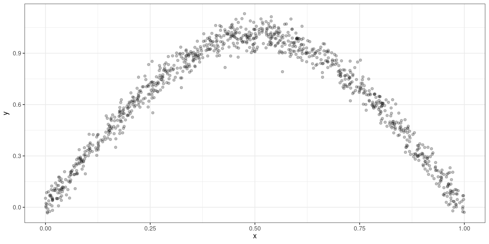
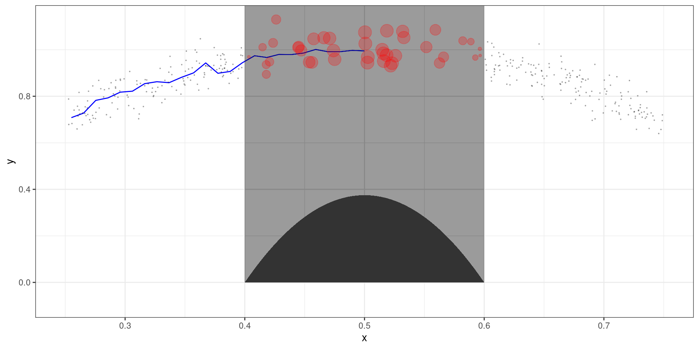

```{python}
#| include: false


import warnings

import numpy as np
import pandas as pd
import statsmodels.api as sm
from plotnine import *
from plotnine.data import mtcars
from scipy.interpolate import make_smoothing_spline
from scipy.special import expit
from sklearn.metrics import mean_squared_error
from sklearn.model_selection import KFold
from statsmodels.gam.api import BSplines, GLMGam
from statsmodels.nonparametric.kernel_regression import KernelReg


warnings.filterwarnings("ignore")

rng = np.random.default_rng(123)


def simulate_polynomial_data(rng, n=1000, x_sd=0.25, error_sd=0.5):
    """Simulate the polynomial relationship used throughout the slides."""
    x = rng.normal(loc=0, scale=x_sd, size=n)
    y = (
        1
        + 5.3 * x
        - 45 * x**2
        - 35.5 * x**3
        + 60 * x**4
        + rng.normal(loc=0, scale=error_sd, size=n)
    )
    return pd.DataFrame({"x": x, "y": y})


# Data for the motivating examples
polynomial_plot_data = simulate_polynomial_data(rng)

x_sine = rng.normal(loc=0, scale=3.5, size=1000)
y_sine = 1 + np.sin(np.pi * x_sine / 8) + rng.normal(
    loc=0,
    scale=0.25,
    size=1000,
)
sinusoidal_plot_data = pd.DataFrame({"x": x_sine, "y": y_sine})

# Separate simulated datasets for the spline and local-regression examples
spline_example_data = simulate_polynomial_data(rng)

# Data for the GAM examples
mtcars_data = mtcars.copy()

x_gam = rng.normal(loc=0, scale=1, size=1000)
y_gam = rng.normal(loc=4, scale=1, size=1000)
mu_gam = np.exp(-2 + expit(x_gam) + np.sqrt(y_gam + 15))
z_gam = rng.poisson(mu_gam)
poisson_gam_data = pd.DataFrame(
    {"x": x_gam, "y": y_gam, "mu": mu_gam, "z": z_gam}
)


```

# Motivating Example

## Plot

```{python}
(
    ggplot(polynomial_plot_data, aes(x="x", y="y"))
    + geom_point()
    + theme_bw()
)
```

## Plot

```{python}
(
    ggplot(sinusoidal_plot_data, aes(x="x", y="y"))
    + geom_point()
    + theme_bw()
)
```

# Smoothing Splines

## Regression Splines

For $L$ knots:

$$
Y = \beta_0 + \sum^p_{j=1}x^j\beta_j + \sum_{l=1}^L \beta_{p+l}(x - \xi_l)^p_+ + \varepsilon
$$

## Issues with Regression Splines

::: incremental
-   Must specify a correct number of knots
-   Must specify the correct location of knots
-   Must specify the degree p
:::

## Solutions

::: incremental
-   Use $p=3$, performs the best
-   Implement a penalty term
:::

## Smooting Parameter

A smoothing (penalty) parameter will allow us to specify a large number of knots to grid up the range of `X`.

::: fragment
The smoothing parameter will force the effect of certain knots to zero that are not relevant.
:::

::: fragment
As long as we choose a high number of knots (20-30), it will properly model the data without the worry of overfitting.
:::

::: fragment
The smoothing parameter can be estimated by using a cross-validation approach and identifying the which values lowers the MSE.
:::

## Likelihood Function

$$
\sum^n_{i=1}\{Y_i-g(X_i)\}^2 + \lambda\int g^{\prime\prime}(t)^2dt
$$

-   $g(\cdot)$: function used to model data (using cubic splines)
-   $\lambda$: smoothing parameter


# Local Regression

## Local Regression

The idea of local regression models is to fit a regression model that is "relatively" close to a point called $x_0$

## Algorithm

- A window is created surrounding $x_0$, this data is used to estimate $y$ at $x_0$
- Data points closer to $x_0$ will have more of importance than data points farther away from $x_0$
    - The importance is determined using a kernel function
- A regression model is fitted with the window data points and importance weights
    - Either Local Constant or Local Linear
- The window size is known as the bandwidth


## Estimation Procedure



## Estimating value $x_0=0.5$




## Local Constant

A local constant model utilizes a weighted mean to determine $f(x_0)$:

$$
\hat f(x_0) = \frac{1}{n} \sum Y_i K(X_i, x_0, h)
$$

where 
- $K(\cdot)$ is known as the kernel function
    - Viewed as a weighting function
- $h$ is the window size.
    - Data points outside the window are set to 0

## Choice of $K(\cdot)$

- Gaussian
- Triweight
- Epanechnikov
- Uniform

## Bandwidth $h$

The choice of bandwidth can be determined via a cross-validation approach.

## Local Constant Model

```{python}
#| echo: false
# 1. Simulate the data
def simulate_polynomial_data(rng, n=1000, x_sd=0.25, error_sd=0.5):
    """Simulate the polynomial relationship used throughout the slides."""
    x = rng.normal(loc=0, scale=x_sd, size=n)
    y = (
        1
        + 5.3 * x
        - 45 * x**2
        - 35.5 * x**3
        + 60 * x**4
        + rng.normal(loc=0, scale=error_sd, size=n)
    )
    return pd.DataFrame({"x": x, "y": y})


rng = np.random.default_rng(909)
data = simulate_polynomial_data(rng)


# 2. Specify the local constant regression model
bandwidth = 0.03

model = KernelReg(
    endog=data["y"].to_numpy(),  # Response variable
    exog=data["x"].to_numpy(),  # Predictor variable
    var_type="c",               # Continuous predictor
    reg_type="lc",              # Local constant regression
    ckertype="gaussian",        # Gaussian kernel weights
    bw=[bandwidth]
)


# 3. Estimate the regression curve on an ordered grid
x_grid = np.linspace(data["x"].min(), data["x"].max(), 500)

y_fitted, _ = model.fit(x_grid)


# 4. Calculate the true curve for comparison
y_true = (
    1
    + 5.3 * x_grid
    - 45 * x_grid**2
    - 35.5 * x_grid**3
    + 60 * x_grid**4
)


# Combine the fitted and true curves into one plotting dataframe
curve_data = pd.DataFrame({
    "x": x_grid,
    "Local constant fit": y_fitted,
    "True relationship": y_true
}).melt(
    id_vars="x",
    var_name="curve",
    value_name="y"
)

plot = (
    ggplot()
    + geom_point(
        data=data,
        mapping=aes(x="x", y="y"),
        color="gray",
        alpha=0.3,
        size=1.2
    )
    + geom_line(
        data=curve_data,
        mapping=aes(
            x="x",
            y="y",
            color="curve",
            linetype="curve"
        ),
        size=1.1
    )
    + scale_color_manual(values={
        "Local constant fit": "blue",
        "True relationship": "black"
    })
    + scale_linetype_manual(values={
        "Local constant fit": "solid",
        "True relationship": "dashed"
    })
    + labs(
        #title="Local Constant Regression",
        title=f"Gaussian kernel; bandwidth = {bandwidth}",
        x="x",
        y="y",
        color="",
        linetype=""
    )
    + theme_minimal()
    + theme(
        figure_size=(10, 6),
        legend_position="bottom"
    )
)

plot.show()

```


## Local Linear Model

Using *Taylor's Expansion* around $x_0$ we can approximate f(x):

$$ 
f(x) = f(x_0) + f^\prime(x_0) (x-x_0)
$$

## Local Linear Model

$$
f(x_0) + f^\prime(x_0) (x-x_0) = \beta_0^{(0)} + \beta_1^{(0)} (X-x_0)
$$

Must find $\hat \beta_0^{(0)}$ and $\beta_1^{(0)}$

## OLS Estimation

$$
\sum^n_{i=1}\left\{Y_i - \beta_0^{(0)} - \beta_1^{(0)} (X_i-x_0)\right\}^2K(X_i,x_0,h)
$$

## Local Linear Model

$$
\hat f(x_0) = \hat\beta^{(0)}_0
$$

## Local Linear Model

```{python}
#| echo: false
# 1. Simulate the data
rng = np.random.default_rng(42)
data = simulate_polynomial_data(rng)

# 2. Specify the local linear regression model
bandwidth = 0.03

model = KernelReg(
    endog=data["y"].to_numpy(),
    exog=data["x"].to_numpy(),
    var_type="c",          # Continuous predictor
    reg_type="ll",         # Local linear regression
    ckertype="gaussian",
    bw=[bandwidth]
)

# 3. Estimate the regression curve
x_grid = np.linspace(data["x"].min(), data["x"].max(), 500)
y_fitted, _ = model.fit(x_grid)

# 4. Calculate the true relationship
y_true = (
    1
    + 5.3 * x_grid
    - 45 * x_grid**2
    - 35.5 * x_grid**3
    + 60 * x_grid**4
)

# 5. Prepare the curves for plotnine
curve_data = pd.DataFrame({
    "x": x_grid,
    "Local linear fit": y_fitted,
    "True relationship": y_true
}).melt(
    id_vars="x",
    var_name="curve",
    value_name="y"
)

# 6. Plot the results
plot = (
    ggplot()
    + geom_point(
        data=data,
        mapping=aes(x="x", y="y"),
        color="gray",
        alpha=0.3,
        size=1.2
    )
    + geom_line(
        data=curve_data,
        mapping=aes(
            x="x", y="y",
            color="curve",
            linetype="curve"
        ),
        size=1.1
    )
    + scale_color_manual(values={
        "Local linear fit": "blue",
        "True relationship": "black"
    })
    + scale_linetype_manual(values={
        "Local linear fit": "solid",
        "True relationship": "dashed"
    })
    + labs(
        #title="Local Linear Regression",
        title=f"Gaussian kernel; bandwidth = {bandwidth}",
        x="x",
        y="y",
        color="",
        linetype=""
    )
    + theme_minimal()
    + theme(
        figure_size=(10, 6),
        legend_position="bottom"
    )
)

plot.show()
```

## Local Constant vs Linear

**Choose Linear Model**

It significantly reduced the asymptotic bias without any increase in the asymptotic variance, from the bias-variance tradeoff.

::: fragment
You can fit higher local polynomial models, but it is usually not worth the increase of the variance. 
:::


# Generalized Additive Models

## Additive Models

Additive Models extends the nonparametric models to include more than one predictor to explain the outcome `Y`.

## Additive Models

$$
Y = \beta_0 + f_1(X_1) + f_2(X_2) + \cdots + f_k(X_k) + \varepsilon
$$

$$
Y = \beta_0 + \sum^k_{j=1} f_j(X_j) +\varepsilon
$$

## Estimation

Each $\hat f_j$ can be estimated using an approach mentioned before.

$$
\hat Y = \hat \beta_0 + \sum^k_{j=1} \hat f_j(X_j)
$$

::: fragment
Each $\hat f_j$ can be estimated differently from other predictor functions.
:::

## GAMs for Non-Normal Variables

GAMs can be extended to model outcome variables that do not follow a normal distribution.


$$
g(\hat Y) = \hat \beta_0 + \sum^k_{j=1} \hat f_j(X_j)
$$

